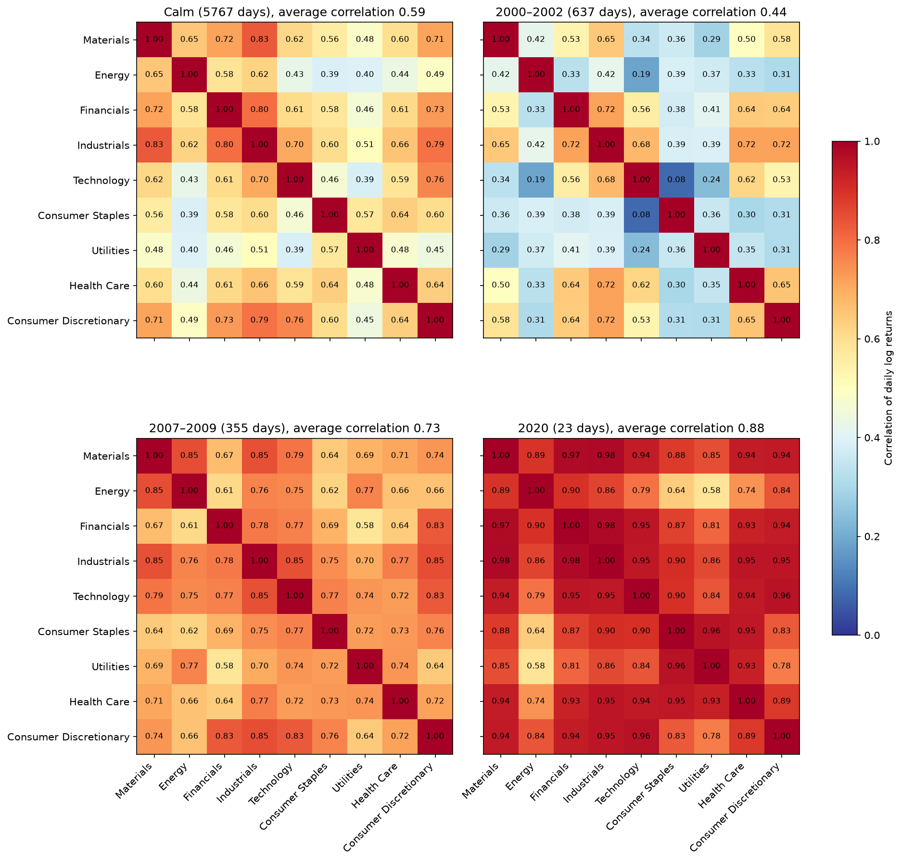
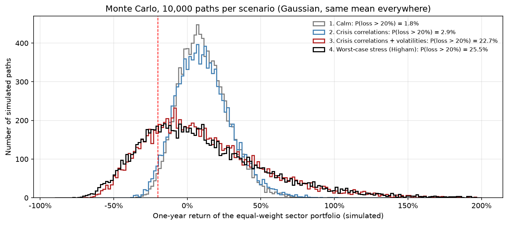
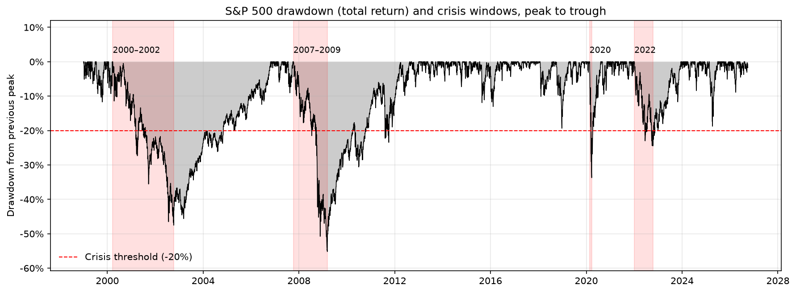
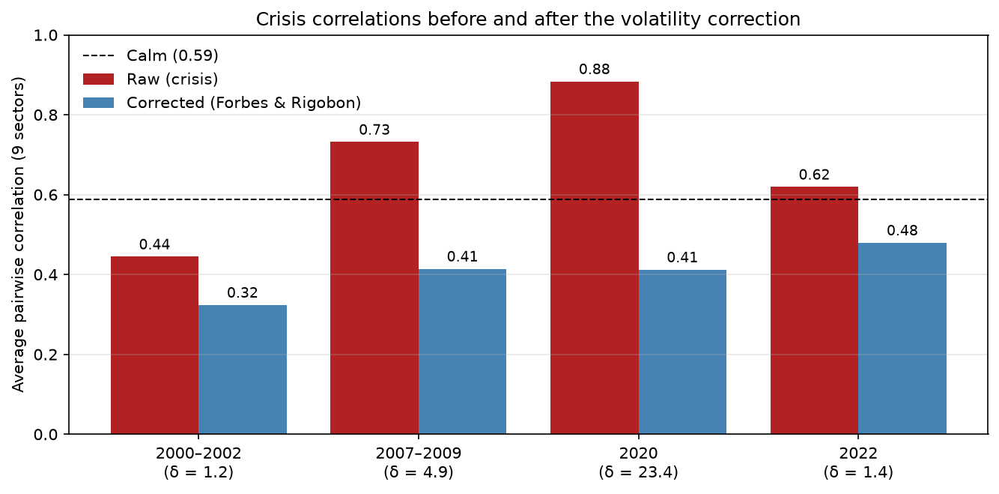
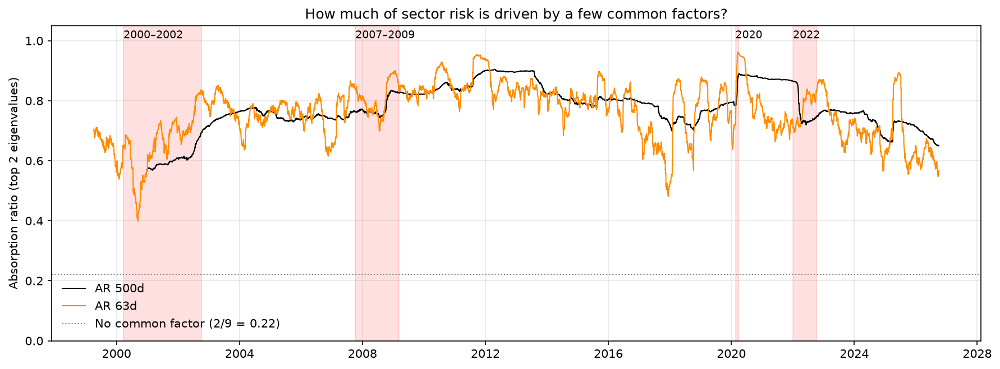

# La diversification sectorielle résiste-t-elle aux crises ?

[English](README.md)

Un portefeuille réparti à parts égales sur les neuf ETF sectoriels historiques du S&P 500 répartit son risque sur toute l'économie. Ce projet teste si cette diversification fonctionne encore quand le marché chute : comment les corrélations et les volatilités des secteurs évoluent en crise, quelle part de cette évolution vient de la volatilité, si les matrices de corrélation utilisées en stress-test restent utilisables pour une simulation, et ce que tout cela implique pour les pertes du portefeuille.

**En bref : ça dépend de la crise, et la diversification sectorielle ne protège pas contre le marché lui-même.** Lors d'une crise sectorielle (2000–2002), les corrélations ont baissé et la diversification a fonctionné. Lors des crises systémiques (2007–2009, 2020), les corrélations sont montées à 0,73–0,88, et un seul facteur a absorbé jusqu'à 90 % de la variance des secteurs. Dans la simulation de Monte-Carlo, le choc de volatilité pèse bien plus lourd que la hausse des corrélations.

## Principaux résultats

| | Résultat |
|:---|:---|
| Corrélation moyenne entre secteurs | 0,59 en période calme ; **0,44** en 2000–2002, **0,73** en 2007–2009, **0,88** en 2020, 0,62 en 2022 |
| Volatilité contre corrélation (simulé) | Probabilité de perdre plus de 20 % sur un an : 1,8 % en calme → 2,9 % avec les corrélations de crise → **22,7 %** avec les corrélations et les volatilités de crise |
| Ratio de diversification | 1,25 en marché calme → **1,05** avec une matrice de stress « pire cas » |
| Correction de Forbes & Rigobon (2002) | Les corrélations de crise tombent à 0,32–0,48, sous le niveau calme : « no contagion, only interdependence » (probablement une surcorrection) |
| Matrice de stress « pire cas » | Corrélation la plus forte de chaque paire sur l'ensemble des crises : matrice **non définie positive** (plus petite valeur propre −0,045), Cholesky échoue ; la matrice de corrélation la plus proche de Higham la répare avec une correction maximale de 0,015 |
| Absorption ratio | Première valeur propre : 64 % de la variance des secteurs en période calme, **90 %** pendant le krach de 2020 |





## Données

| | |
|:---|:---|
| Actifs | Neuf ETF sectoriels SPDR (XLB, XLE, XLF, XLI, XLK, XLP, XLU, XLV, XLY) et le SPY comme référence de marché — Yahoo Finance via `yfinance`, cours de clôture ajustés (dividendes réinvestis) |
| Exclus | XLRE (immobilier, lancé en 2015) et XLC (services de communication, lancé en 2018) : trop récents |
| Période | 5 janvier 1999 – 30 septembre 2026 : 6 977 jours de bourse communs |
| Traitement | Jours communs conservés avant le calcul des rendements ; rendements log pour les covariances, les corrélations et les valeurs propres ; rendements simples pour les drawdowns et le Monte-Carlo |
| Crises | Baisses du SPY (dividendes inclus) d'au moins 20 %, du sommet au creux, détectées dans les données : 2000–2002 (637 jours), 2007–2009 (355), 2020 (23), 2022 (195) |
| Portefeuille | Poids égaux sur les neuf secteurs, rebalancés chaque jour |

**Outils :** Python, pandas, NumPy, matplotlib, yfinance.

## Méthodologie

| Étape | Contenu |
|:---|:---|
| 1. Données | Téléchargement avec contrôle explicite des tickers en échec ; jours communs ; contrôles de cohérence |
| 2. Détection des crises | Baisses du SPY d'au moins 20 %, du sommet au creux ; tous les autres jours sont calmes |
| 3. Covariance et corrélation | Matrices calme contre crise ; conversion Σ = DRD vérifiée dans les deux sens ; symétrie ; caractère défini et semi-défini positif testé par les valeurs propres |
| 4. Correction de la volatilité | Ajustement de Forbes & Rigobon (2002) des corrélations de crise, avec δ calculé sur la variance du SPY |
| 5. Absorption ratio | Diagonalisation R = BΛBᵀ par régime et sur des fenêtres glissantes de 500 et 63 jours (Kritzman et al., 2011) |
| 6. Matrices de stress | Matrices « pire cas » et d'expert incohérent qui font échouer Cholesky ; réparation par écrêtage des valeurs propres (Rebonato & Jäckel, 2000) et par la matrice de corrélation la plus proche de Higham (2002) |
| 7. Monte-Carlo | Simulation par Cholesky X = μ + diag(σ)LZ, 10 000 trajectoires d'un an par scénario, même moyenne partout : calme, corrélations de crise, corrélations et volatilités de crise, stress « pire cas » |

## Autres résultats

| Régime | Jours | Volatilité moyenne des secteurs | Corrélation moyenne | Plus petite valeur propre | Absorption ratio (n = 2) |
|:---|:---|:---|:---|:---|:---|
| Calme | 5 767 | 18,8 % | 0,59 | 0,141 | 72,9 % |
| 2000–2002 | 637 | 28,4 % | 0,44 | 0,185 | 65,7 % |
| 2007–2009 | 355 | 41,1 % | 0,73 | 0,106 | 82,9 % |
| 2020 | 23 | 86,4 % | 0,88 | 0,008 | 96,5 % |
| 2022 | 195 | 26,0 % | 0,62 | 0,069 | 78,1 % |

| Scénario Monte-Carlo (simulé) | Volatilité du portefeuille | Ratio de diversification | P(perte > 20 %) à 1 an |
|:---|:---|:---|:---|
| 1. Calme | 15,1 % | 1,25 | 1,75 % |
| 2. Corrélations de crise | 16,5 % | 1,14 | 2,91 % |
| 3. Corrélations et volatilités de crise | 35,9 % | 1,15 | 22,67 % |
| 4. Stress « pire cas » (Higham) | 39,1 % | 1,05 | 25,47 % |







## Limites

- Les crises sont définies par les baisses du SPY, ce qui sélectionne des jours de marché baissier et gonfle les corrélations. Le seuil de 20 % est une convention : 2018 et 2025 s'en sont approchés et sont traités comme des périodes calmes.
- La crise de 2020 ne compte que 23 observations : ses corrélations sont bruitées et sa matrice est presque singulière.
- La correction de Forbes & Rigobon suppose un choc commun unique et une variance propre des secteurs constante, et a tendance à trop corriger (Corsetti, Pericoli & Sbracia, 2005).
- Les fenêtres glissantes à poids égaux créent des ruptures quand des jours extrêmes sortent de la fenêtre ; l'absorption ratio est calculé sur les corrélations et n'est pas testé comme signal d'alerte.
- Le Monte-Carlo est gaussien et i.i.d. : pas de queues épaisses ni de grappes de volatilité. Il donne une probabilité nulle de perdre plus de 10 % en un jour, alors que le SPY a perdu 10,9 % le 16 mars 2020. Une loi de Student multivariée serait l'extension naturelle. La volatilité de crise est supposée durer un an entier, et la même moyenne positive est utilisée dans tous les scénarios.
- Les neuf secteurs sont des grandes capitalisations américaines exposées au même facteur de marché : le résultat porte sur la diversification sectorielle, pas sur la diversification entre classes d'actifs. Le rebalancement quotidien ignore les frais de transaction.

## Exécution

```bash
git clone https://github.com/mattondidier/financial-data-lab.git
cd financial-data-lab
python -m venv venv
venv\Scripts\activate            # Windows  |  source venv/bin/activate sous macOS/Linux
pip install -r requirements.txt
```

Ouvrez ensuite `06-diversification-under-stress/diversification_under_stress.ipynb` et exécutez toutes les cellules. Aucune clé d'API n'est nécessaire. Les graphiques sont enregistrés dans `assets/`.

## Références

- Corsetti, G., Pericoli, M., & Sbracia, M. (2005). "Some contagion, some interdependence": More pitfalls in tests of financial contagion. *Journal of International Money and Finance*, 24(8), 1177–1199.
- Forbes, K. J., & Rigobon, R. (2002). No contagion, only interdependence: Measuring stock market comovements. *Journal of Finance*, 57(5), 2223–2261.
- Higham, N. J. (2002). Computing the nearest correlation matrix — a problem from finance. *IMA Journal of Numerical Analysis*, 22(3), 329–343.
- Kritzman, M., Li, Y., Page, S., & Rigobon, R. (2011). Principal components as a measure of systemic risk. *Journal of Portfolio Management*, 37(4), 112–126.
- Rebonato, R., & Jäckel, P. (2000). The most general methodology for creating a valid correlation matrix for risk management and option pricing purposes. *Journal of Risk*, 2(2), 17–27.

---

**Didier Matton** | Ingénieur financier | Data Scientist Full Stack | Python, Django, VBA, BI & LLMs | Finance quantitative
