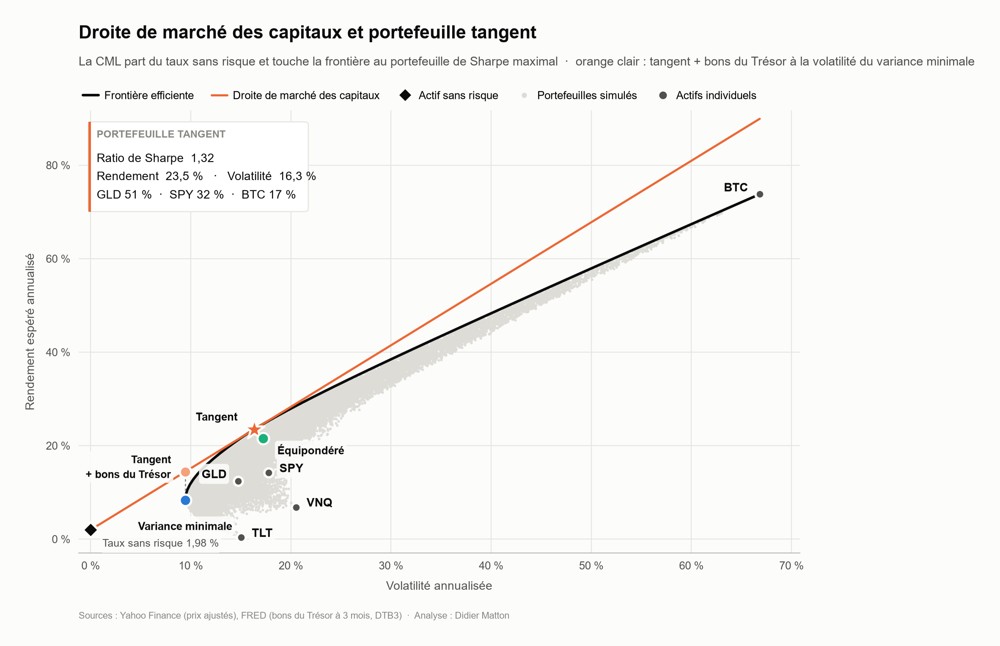
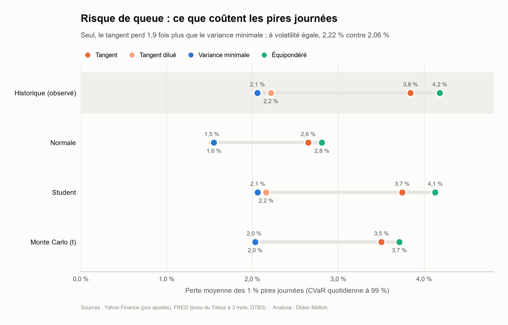
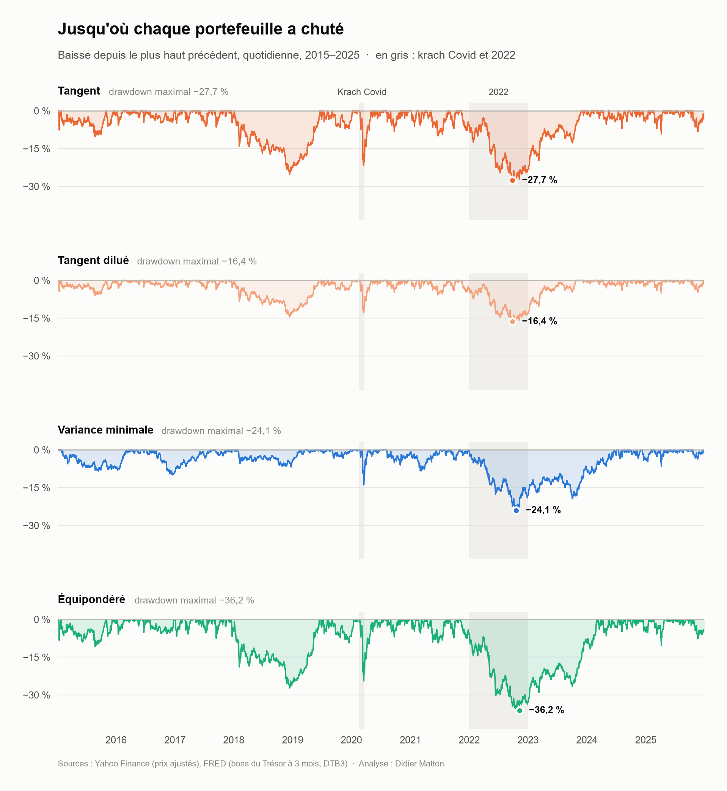
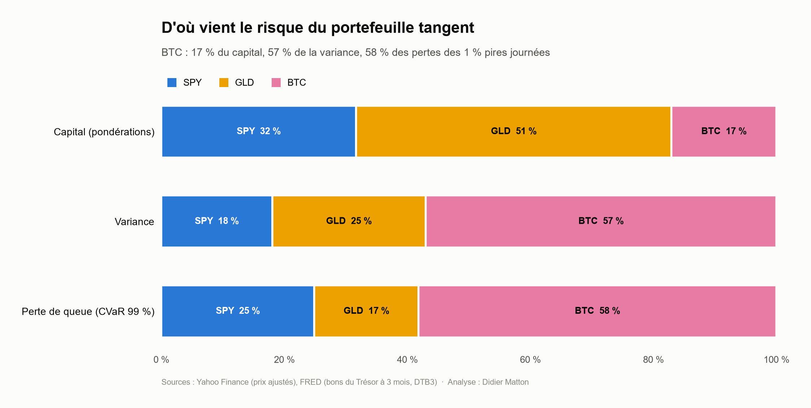
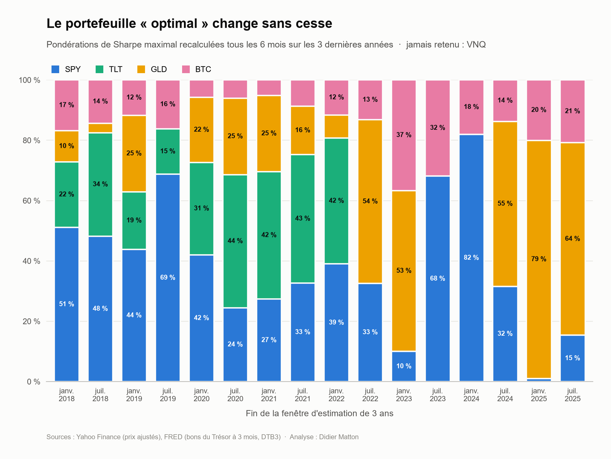
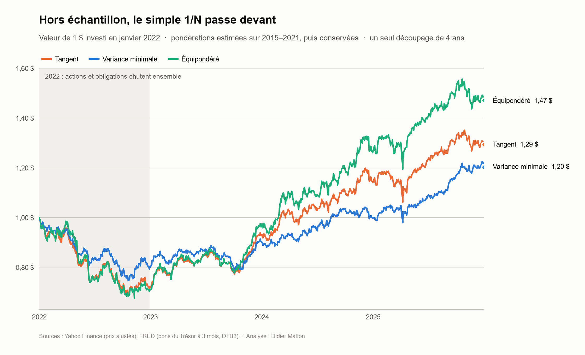

# Frontière efficiente et risque de perte

🇬🇧 [English version](README.md)

> **Le portefeuille optimal au sens de Sharpe est-il aussi le moins risqué quand le marché chute ?**
>
> **Pas en absolu, et à risque égal, cela dépend du type de crise.** Détenu seul, le portefeuille tangent perd près de deux fois plus que la variance minimale lors de ses 1 % pires journées (CVaR 99 % de 3,84 % contre 2,06 %), ce qui est attendu puisque la variance minimale est le moins volatil par construction. Dilué avec des bons du Trésor jusqu'à la même volatilité de 9,4 %, comme le prévoit la droite de marché des capitaux, il rapporte presque deux fois plus sur l'échantillon d'estimation (14,4 % contre 8,3 %) avec une queue à peine plus épaisse. Il a davantage perdu dans le krach brutal du Covid (−10,6 % contre −7,5 %), mais beaucoup moins dans le choc de taux de 2022 (−10,3 % contre −18,4 %).



---

## Présentation

L'optimisation moyenne-variance retient le portefeuille qui offre le meilleur rendement par unité de volatilité. Mais la volatilité traite hausses et baisses de la même façon et ne dit rien de la profondeur des chutes lors des pires journées. Ce projet construit la frontière efficiente d'un univers de cinq actifs, puis teste le portefeuille tangent sur deux plans : la **stabilité** de ses pondérations et son **risque de perte**, face aux portefeuilles de variance minimale et équipondéré, et **à risque égal** avec un tangent dilué par des bons du Trésor jusqu'à la volatilité de la variance minimale.

| | |
|---|---|
| **Actifs** | SPY (actions américaines), TLT (obligations du Trésor américain à long terme), GLD (or), VNQ (immobilier coté américain), BTC-USD (Bitcoin) |
| **Période** | Janvier 2015 – décembre 2025, données quotidiennes (2 766 jours de bourse communs) |
| **Données** | Prix ajustés via l'API Yahoo Finance (`yfinance`) ; taux des bons du Trésor à 3 mois (DTB3) via l'API FRED (`fredapi`) |
| **Outils** | Python, pandas, NumPy, SciPy (optimisation SLSQP, lois de probabilité), Matplotlib |

## Méthode

1. **Données et contrôle de qualité.** Les prix sont alignés sur les jours de bourse communs *avant* le calcul des rendements : les mouvements du Bitcoin du week-end sont ainsi intégrés à son rendement du lundi. Le taux sans risque est le taux quotidien réel des bons du Trésor (1,98 % en moyenne), et non une constante.
2. **Frontière efficiente.** 20 000 portefeuilles sans vente à découvert simulés par une loi de Dirichlet (graine fixée), et la frontière exacte obtenue par optimisation SLSQP.
3. **Portefeuille tangent et CML.** Portefeuille de Sharpe maximal, validé par la simulation (meilleur Sharpe simulé 1,3115 < tangent 1,3160).
4. **Stabilité et test hors échantillon.** Pondérations du portefeuille tangent recalculées sur des fenêtres glissantes de 3 ans tous les 6 mois ; les trois portefeuilles estimés sur 2015-2021 puis conservés tels quels sur 2022-2025.
5. **Risque de perte à risque égal.** Un quatrième portefeuille mélange le tangent et des bons du Trésor (≈ 58 % / 42 %) pour atteindre la volatilité de la variance minimale. VaR et CVaR quotidiennes à 95 % et 99 % selon quatre méthodes (historique, normale, Student ajustée par maximum de vraisemblance, Monte Carlo par Student multivariée), CVaR par unité de volatilité quotidienne, stress tests (krach Covid, 2022), drawdowns, et contributions de chaque actif à la variance et à la CVaR.

## Résultats

### Les trois portefeuilles

| | SPY | TLT | GLD | VNQ | BTC | Rendement | Volatilité | Sharpe |
|---|---|---|---|---|---|---|---|---|
| **Tangent** | 31,7 % | 0 % | 51,3 % | 0 % | 17,1 % | 23,5 % | 16,3 % | **1,32** |
| **Variance minimale** | 33,1 % | 38,9 % | 28,0 % | 0 % | 0 % | 8,3 % | 9,4 % | 0,67 |
| **Équipondéré** | 20 % | 20 % | 20 % | 20 % | 20 % | 21,5 % | 17,2 % | 1,13 |

### Seul ou à risque égal

| | Volatilité | Rendement | CVaR 99 % | CVaR / vol. quotidienne | Krach Covid | 2022 | Drawdown max |
|---|---|---|---|---|---|---|---|
| Tangent | 16,3 % | 23,5 % | 3,84 % | 3,73 | −18,2 % | −19,0 % | −27,7 % |
| **Tangent dilué** | **9,4 %** | **14,4 %** | 2,22 % | 3,73 | −10,6 % | **−10,3 %** | **−16,4 %** |
| **Variance minimale** | **9,4 %** | 8,3 % | **2,06 %** | 3,46 | **−7,5 %** | −18,4 % | −24,1 % |
| Équipondéré | 17,2 % | 21,5 % | 4,18 % | 3,85 | −20,7 % | −29,2 % | −36,2 % |

À volatilité égale, le tangent dilué rapporte presque deux fois plus que la variance minimale, avec une queue à peine plus épaisse par unité de risque (une loi normale donnerait 2,67 volatilités quotidiennes). La variance minimale protège mieux dans un krach brutal, le tangent dilué dans un choc de taux.

> **Réserve.** La comparaison de 2022 est in-sample : le tangent estimé sur tout l'échantillon ne détient pas de TLT, en partie parce qu'il a été estimé sur des données qui incluent le krach obligataire de 2022. Estimé sur 2015-2021 seulement, il détenait 38 % de TLT et est tombé à 0,69 $ par dollar en 2022, sous la variance minimale (0,75 $, section 5 du notebook). Le résultat du Covid est robuste ; celui de 2022 et l'avantage de rendement (pondérations choisies après coup sur l'or et le Bitcoin) sont optimistes pour le tangent.





### Le Bitcoin porte le risque de queue du portefeuille tangent

Le Bitcoin représente 17 % du capital, mais 57 % de la variance et 58 % des pertes des 1 % pires journées. L'or, à 51 % du capital, ne pèse que 17 % de la CVaR.



### Hors échantillon, le simple 1/N passe devant, dans la marge d'erreur

| | Sharpe (2015-2021) | Sharpe (2022-2025) | 1 $ devient |
|---|---|---|---|
| Tangent | 1,61 | 0,24 | 1,29 $ |
| Équipondéré | 1,51 | **0,43** | **1,47 $** |
| Variance minimale | 1,02 | 0,11 | 1,20 $ |

Sur un seul test de 4 ans, l'erreur-type d'un ratio de Sharpe est d'environ 0,5 (Lo, 2002) : ces écarts ne sont pas statistiquement significatifs.





## Enseignements

1. **La volatilité ne voit pas la forme de la queue, mais par unité de risque, les queues se ressemblent.** Les rendements ont des queues épaisses (excès de kurtosis de 5,9 à 9,6) : une VaR normale sous-estime la CVaR à 99 % de 25 à 33 %, alors qu'une loi de Student reproduit fidèlement le risque historique. En volatilités quotidiennes, la CVaR à 99 % reste entre 3,46 et 3,85 pour tous les portefeuilles.
2. **Le risque de queue du tangent est concentré** sur le Bitcoin, retenu par l'optimiseur pour son rendement moyen passé, et non pour un risque faible.
3. **La protection de la variance minimale est un pari sur les corrélations.** Elle repose sur les obligations longues comme couverture des actions : cela a fonctionné pendant le krach Covid et échoué en 2022, quand actions et obligations ont chuté ensemble.
4. **Les pondérations optimales sont instables** (SPY de 1 % à 82 %, GLD de 0 % à 79 % selon la fenêtre), car elles dépendent d'estimations très bruitées des rendements espérés, et leur avantage hors échantillon n'est pas démontré.

**En pratique,** le tangent combiné à de l'actif sans risque est un cœur de portefeuille cohérent à risque égal, mais ses pondérations ne doivent pas être appliquées telles qu'estimées. Une allocation robuste doit contrôler le risque de queue (contrainte de CVaR, plafond par actif, budget de risque), éviter de dépendre d'une seule couverture comme les obligations longues, et tenir compte de l'erreur d'estimation des rendements espérés.

## Limites

- Les pondérations des sections frontière, tangent et risque de perte sont estimées sur tout l'échantillon (analyse *in-sample*).
- Pondérations constantes (rééquilibrage quotidien implicite), sans coûts de transaction ; un seul découpage hors échantillon.
- Le tangent dilué prête au taux des bons du Trésor (aucun emprunt nécessaire, puisqu'on investit moins de 100 % dans le tangent).
- Calendrier boursier américain : les mouvements du Bitcoin du week-end sont reportés sur le lundi (par exemple −22,7 % le 13 juin 2022, contre −16,0 % pour ce lundi seul).
- Cinq actifs, ventes à découvert interdites. Monte Carlo avec ν = 5 fixé, soit des queues un peu moins épaisses que les valeurs ajustées (3,6 à 4,5).

## Références

- Markowitz, H. (1952). Portfolio Selection. *Journal of Finance*, 7(1), 77–91.
- Sharpe, W. F. (1964). Capital Asset Prices: A Theory of Market Equilibrium under Conditions of Risk. *Journal of Finance*, 19(3), 425–442.
- Chopra, V. K., & Ziemba, W. T. (1993). The Effect of Errors in Means, Variances, and Covariances on Optimal Portfolio Choice. *Journal of Portfolio Management*, 19(2), 6–11.
- Rockafellar, R. T., & Uryasev, S. (2000). Optimization of Conditional Value-at-Risk. *Journal of Risk*, 2(3), 21–41.
- Lo, A. W. (2002). The Statistics of Sharpe Ratios. *Financial Analysts Journal*, 58(4), 36–52.
- DeMiguel, V., Garlappi, L., & Uppal, R. (2009). Optimal Versus Naive Diversification: How Inefficient Is the 1/N Portfolio Strategy? *Review of Financial Studies*, 22(5), 1915–1953.

## Exécution

```bash
# depuis la racine du dépôt (un seul requirements.txt pour tous les projets)
pip install -r requirements.txt
echo 'FRED_API_KEY=votre_cle' >> .env  # clé gratuite : https://fred.stlouisfed.org/docs/api/api_key.html
jupyter notebook 07-efficient-frontier-downside-risk/07_efficient_frontier_downside_risk.ipynb
```

La clé est chargée depuis un fichier `.env` avec `python-dotenv` (fichier exclu de git) et n'est jamais enregistrée dans le notebook. Les figures sont enregistrées dans `assets/`.

## Structure

```
07-efficient-frontier-downside-risk/
├── 07_efficient_frontier_downside_risk.ipynb   # analyse complète (fonctions + cellules d'exécution)
├── assets/                                     # figures (EN et _fr)
├── README.md
└── README.fr.md
```

---

**Didier Matton** | Ingénieur financier | Data Scientist Full Stack | Python, Django, VBA, BI & LLMs | Finance quantitative
