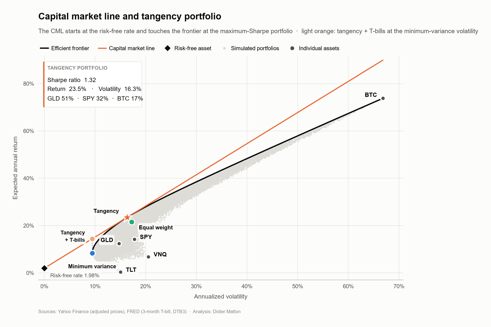
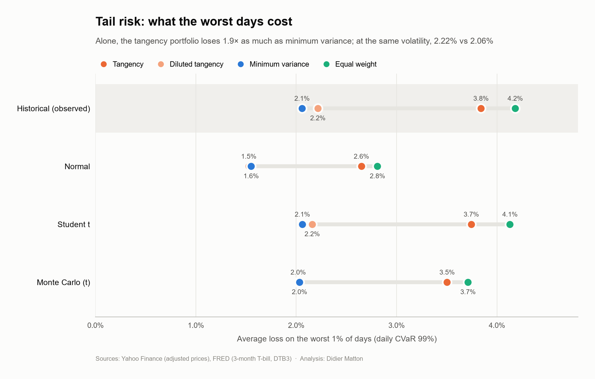
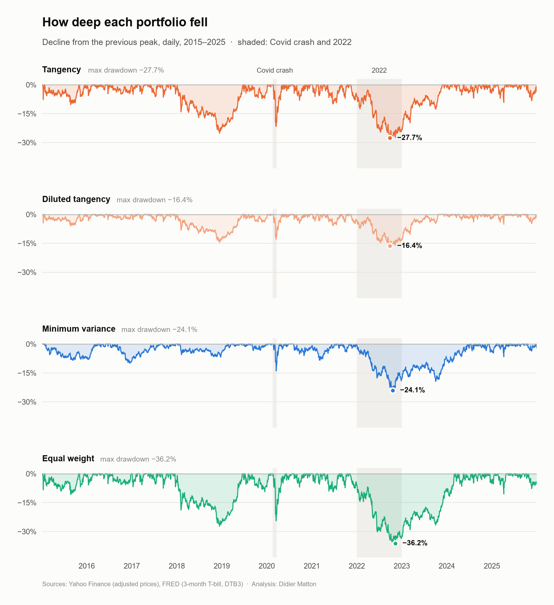
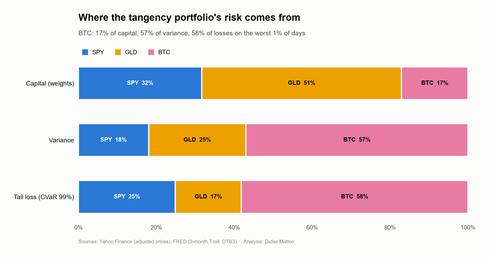
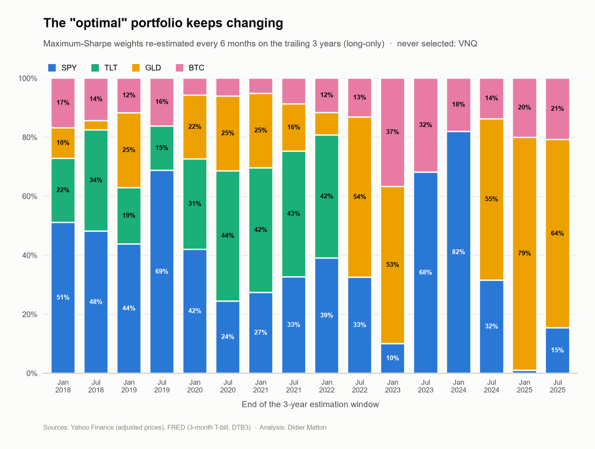
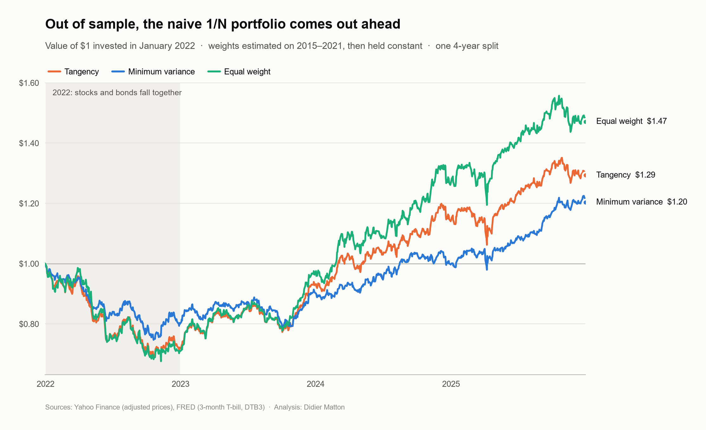

# Efficient Frontier & Downside Risk

🇫🇷 [Version française](README.fr.md)

> **Is the Sharpe-optimal portfolio also the least risky when markets fall?**
>
> **Not in absolute terms — and at equal risk, it depends on the type of crisis.** Held alone, the tangency portfolio loses almost twice as much as the minimum-variance portfolio on its worst 1% of days (99% CVaR of 3.84% vs 2.06%), which is expected since minimum variance is the least volatile by construction. Diluted with T-bills to the same 9.4% volatility, as the capital market line prescribes, it earns almost twice as much in-sample (14.4% vs 8.3%) with a barely heavier tail. It lost more in the sudden Covid crash (−10.6% vs −7.5%), but much less in the 2022 rate shock (−10.3% vs −18.4%).



---

## Overview

Mean-variance optimization selects the portfolio with the best return per unit of volatility. But volatility treats gains and losses symmetrically and says nothing about how deep a portfolio falls on its worst days. This project builds the efficient frontier of a five-asset universe, then tests the tangency portfolio on two fronts: the **stability** of its weights and its **downside risk**, compared with the minimum-variance and equal-weight portfolios, and at **equal risk** with a tangency portfolio diluted with T-bills to the minimum-variance volatility.

| | |
|---|---|
| **Universe** | SPY (US equities), TLT (long-term US Treasuries), GLD (gold), VNQ (US REITs), BTC-USD (Bitcoin) |
| **Period** | January 2015 – December 2025, daily data (2,766 common trading days) |
| **Data** | Adjusted close prices from the Yahoo Finance API (`yfinance`); 3-month T-bill rate (DTB3) from the FRED API (`fredapi`) |
| **Stack** | Python, pandas, NumPy, SciPy (SLSQP optimization, distributions), Matplotlib |

## Method

1. **Data and quality control.** Prices are aligned on common trading days *before* returns are computed, so Bitcoin's weekend moves are folded into its Monday return. The risk-free rate is the actual daily T-bill rate (average 1.98%), not a constant.
2. **Efficient frontier.** 20,000 long-only portfolios simulated from a Dirichlet distribution (fixed seed), and the exact frontier obtained by SLSQP optimization.
3. **Tangency portfolio and CML.** Maximum-Sharpe portfolio, validated against the simulation (best simulated Sharpe 1.3115 < tangency 1.3160).
4. **Stability and out-of-sample test.** Tangency weights re-estimated on 3-year rolling windows every 6 months; the three portfolios estimated on 2015–2021 and held unchanged over 2022–2025.
5. **Downside risk at equal risk.** A fourth portfolio mixes the tangency portfolio with T-bills (≈ 58% / 42%) to match the minimum-variance volatility. Daily VaR and CVaR at 95% and 99% under four methods (historical, normal, Student t fitted by maximum likelihood, Monte Carlo with a multivariate Student t), CVaR per unit of daily volatility, stress tests (Covid crash, 2022), drawdowns, and variance and CVaR contributions by asset.

## Results

### The three portfolios

| | SPY | TLT | GLD | VNQ | BTC | Return | Volatility | Sharpe |
|---|---|---|---|---|---|---|---|---|
| **Tangency** | 31.7% | 0% | 51.3% | 0% | 17.1% | 23.5% | 16.3% | **1.32** |
| **Minimum variance** | 33.1% | 38.9% | 28.0% | 0% | 0% | 8.3% | 9.4% | 0.67 |
| **Equal weight** | 20% | 20% | 20% | 20% | 20% | 21.5% | 17.2% | 1.13 |

### Alone vs at equal risk

| | Volatility | Return | CVaR 99% | CVaR / daily vol | Covid crash | 2022 | Max drawdown |
|---|---|---|---|---|---|---|---|
| Tangency | 16.3% | 23.5% | 3.84% | 3.73 | −18.2% | −19.0% | −27.7% |
| **Diluted tangency** | **9.4%** | **14.4%** | 2.22% | 3.73 | −10.6% | **−10.3%** | **−16.4%** |
| **Minimum variance** | **9.4%** | 8.3% | **2.06%** | 3.46 | **−7.5%** | −18.4% | −24.1% |
| Equal weight | 17.2% | 21.5% | 4.18% | 3.85 | −20.7% | −29.2% | −36.2% |

At the same volatility, the diluted tangency portfolio earns almost twice as much as minimum variance, with a tail barely heavier per unit of risk (a normal distribution would give 2.67 daily volatilities). Minimum variance protects better in a sudden crash, the diluted tangency portfolio in a rate shock.

> **Caveat.** The 2022 comparison is in-sample: the full-sample tangency portfolio holds no TLT partly because it was estimated on data that include the 2022 bond crash. Estimated on 2015–2021 only, it held 38% TLT and fell to $0.69 per dollar in 2022, below the minimum-variance portfolio ($0.75, section 5). The Covid result is robust; the 2022 result and the return advantage (weights chosen with hindsight on gold and Bitcoin) are optimistic for the tangency portfolio.





### Bitcoin drives the tangency portfolio's tail risk

Bitcoin is 17% of capital but 57% of variance and 58% of losses on the worst 1% of days. Gold, at 51% of capital, accounts for only 17% of the CVaR.



### Out of sample, the naive 1/N portfolio comes out ahead — within noise

| | Sharpe (2015–2021) | Sharpe (2022–2025) | Growth of $1 |
|---|---|---|---|
| Tangency | 1.61 | 0.24 | $1.29 |
| Equal weight | 1.51 | **0.43** | **$1.47** |
| Minimum variance | 1.02 | 0.11 | $1.20 |

Over a single 4-year test, the standard error of a Sharpe ratio is about 0.5 (Lo, 2002): these differences are not statistically significant.





## Key findings

1. **Volatility misses the shape of the tail, but per unit of risk the tails are similar.** Returns have fat tails (excess kurtosis 5.9 to 9.6): a normal VaR understates the 99% CVaR by 25% to 33%, while a Student t matches historical risk closely. In daily volatilities, the 99% CVaR stays between 3.46 and 3.85 for all portfolios.
2. **The tangency portfolio's tail risk is concentrated** in Bitcoin, accepted by the optimizer for its past mean return, not for its low risk.
3. **Minimum-variance protection is a bet on correlations.** It relies on long bonds hedging equities: it worked in the Covid crash and failed in 2022, when stocks and bonds fell together.
4. **Optimal weights are unstable** (SPY from 1% to 82%, GLD from 0% to 79% across windows), driven by noisy estimates of expected returns, and their out-of-sample edge is not demonstrated.

**In practice,** the tangency portfolio combined with cash is a sensible risky core at equal risk, but its weights should not be implemented as estimated. A robust allocation should control tail risk (CVaR constraint, per-asset caps, risk budgeting), avoid relying on a single hedge such as long bonds, and account for estimation error in expected returns.

## Limitations

- Weights for the frontier, tangency and downside-risk sections are estimated on the full sample (in-sample analysis).
- Constant weights (implicit daily rebalancing), no transaction costs; a single out-of-sample split.
- The diluted portfolio lends at the T-bill rate (no borrowing needed, since less than 100% is invested in the tangency portfolio).
- US trading calendar: Bitcoin's weekend moves are folded into Monday's return (e.g. −22.7% on 13 June 2022 vs −16.0% for that Monday alone).
- Five assets, long-only. Monte Carlo with a fixed ν = 5, slightly thinner tails than the fitted values (3.6 to 4.5).

## References

- Markowitz, H. (1952). Portfolio Selection. *Journal of Finance*, 7(1), 77–91.
- Sharpe, W. F. (1964). Capital Asset Prices: A Theory of Market Equilibrium under Conditions of Risk. *Journal of Finance*, 19(3), 425–442.
- Chopra, V. K., & Ziemba, W. T. (1993). The Effect of Errors in Means, Variances, and Covariances on Optimal Portfolio Choice. *Journal of Portfolio Management*, 19(2), 6–11.
- Rockafellar, R. T., & Uryasev, S. (2000). Optimization of Conditional Value-at-Risk. *Journal of Risk*, 2(3), 21–41.
- Lo, A. W. (2002). The Statistics of Sharpe Ratios. *Financial Analysts Journal*, 58(4), 36–52.
- DeMiguel, V., Garlappi, L., & Uppal, R. (2009). Optimal Versus Naive Diversification: How Inefficient Is the 1/N Portfolio Strategy? *Review of Financial Studies*, 22(5), 1915–1953.

## Run it

```bash
# from the repository root (single requirements.txt for all projects)
pip install -r requirements.txt
echo 'FRED_API_KEY=your_key' >> .env  # free key: https://fred.stlouisfed.org/docs/api/api_key.html
jupyter notebook 07-efficient-frontier-downside-risk/07_efficient_frontier_downside_risk.ipynb
```

The key is loaded from a `.env` file with `python-dotenv` (the file is git-ignored) and is never stored in the notebook. Figures are saved to `assets/`.

## Structure

```
07-efficient-frontier-downside-risk/
├── 07_efficient_frontier_downside_risk.ipynb   # full analysis (functions + execution cells)
├── assets/                                     # figures (EN and _fr)
├── README.md
└── README.fr.md
```

---

**Didier Matton** | Financial Engineer | Full-Stack Data Scientist | Python, Django, VBA, BI & LLMs | Quantitative Finance
